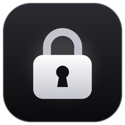
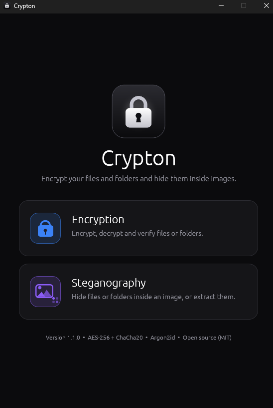
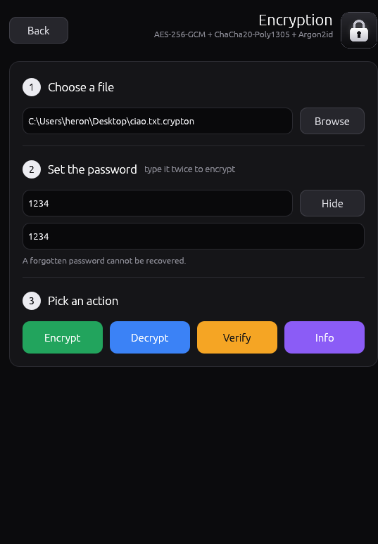
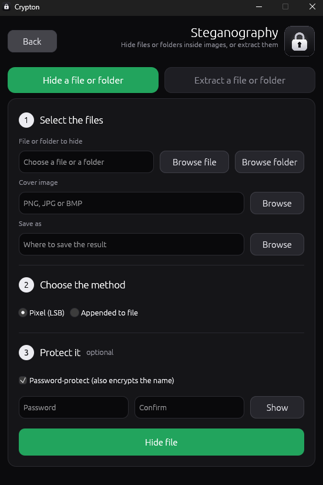

<p align="center"></p>

<h1 align="center">Crypton</h1>

<p align="center">
Open-source desktop app to <b>encrypt files and folders</b> with a password and <b>hide them inside images</b>.<br>
One self-contained file. No installation, no dependencies, no traces left on your system.
</p>

---

## Screenshots

<p align="center">
  
  &nbsp;
  
  &nbsp;
  
</p>
<p align="center"><sub>Start screen &nbsp;·&nbsp; Encryption &nbsp;·&nbsp; Steganography</sub></p>

## Features

**Encryption**
- Encrypts and decrypts **any file or whole folder** with a password, producing a single `.crypton` file. A folder keeps its sub-folders, empty folders and every file; decrypting rebuilds it.
- The original **file or folder name is stored encrypted** inside the file and suggested again when decrypting, even if the file was renamed.
- Content is **compressed** before encryption when it is worthwhile.
- **Verify**: without a password it checks the structure of an encrypted file; with the password it runs the complete authenticity check. Nothing is written to disk.
- **Info**: shows the details of an encrypted file or of an image with hidden data.

**Steganography**
- **Pixel (LSB)** method: spreads the data over the least significant bits of the pixels, evenly over the whole image. The result is saved as PNG or BMP only (lossy formats would destroy the data).
- **Appended** method: adds the data after the end of the image file. The image stays byte-for-byte identical and displays normally.
- Extraction **detects the method by itself** and whether a password is needed.
- You can hide a **single file or a whole folder**; extraction rebuilds the folder by itself.
- The hidden content can be password-protected; in that case its **name is encrypted** too.

**Interface**
- Dark, minimal, fixed-size window with numbered steps, colored action buttons and a notification system.
- Same look and behavior on Windows and Linux.

## How to use it

The start screen has two options: **Encryption** and **Steganography**. **Back** returns to the menu.

### Encryption

1. **Choose a file or a folder**: click **Browse file** or **Browse folder**, or paste the path. To decrypt, choose the `.crypton` file.
2. **Set the password**: type it twice when encrypting. **Show** reveals what you typed.
3. **Pick an action**:
   - **Encrypt** (green): asks where to save the `.crypton` file (outside the folder, when encrypting a folder).
   - **Decrypt** (blue): checks everything first, then asks where to save the file, or in which folder to rebuild the original folder.
   - **Verify** (orange): integrity check, no files written.
   - **Info** (violet): shows the details below the card.

### Steganography

Two clearly separated tabs: **Hide a file or folder** (green) and **Extract a file or folder** (blue).

**Hide a file or folder**
1. **Select the files**: the file or folder to hide (**Browse file** / **Browse folder** buttons), the cover image (PNG, JPG or BMP) and where to save the result. The output name is suggested automatically.
2. **Choose the method**: *Pixel (LSB)* or *Appended to file* (hover an option for details).
3. **Protect it** (optional): tick the box and type the password twice.

**Extract a file or folder**
1. **Select the image**; the method is detected automatically.
2. **Choose the destination folder**.
3. **Enter the password**, only if the content is protected.

> A forgotten password cannot be recovered. Use a long passphrase (12+ characters, or several random words).

## Notifications

Every action reports its outcome with a notification in the top-right corner. They stack, disappear by themselves after **3 seconds** and can be closed earlier with the X.

| Type | Color | Stays | Examples |
|---|---|---|---|
| Info | blue | 3 s | file selected, operation started, hidden content found, information loaded |
| Success | green | 3 s | file encrypted / decrypted / hidden / extracted (with the saved path and the time taken), integrity verified |
| Warning | amber | 3 s | weak password, hidden file not protected, operation cancelled |
| Error | red | 3 s | wrong password, damaged or invalid file, integrity compromised, missing fields, passwords that do not match |

A violet notification with a progress bar is shown while an operation is running.

## Security

- **Double encryption with two independent algorithms.** Every block is sealed with **ChaCha20-Poly1305** and the result is sealed again with **AES-256-GCM**, each with its own 256-bit key. An attacker would have to break both. Both are authenticated: if the file is modified, even by one bit, or truncated, Crypton refuses to open it.
- **Key derivation:** **Argon2id** with 256 MiB of memory and 4 passes (about one second on a modern computer), followed by **HKDF-SHA-512**, which splits the result into the two keys and binds them to the file header.
- **Fresh random 256-bit salt** for every operation: two files encrypted with the same password are different.
- **The password is never stored.**
- **Memory hygiene:** keys, passwords and data are wiped as soon as they are no longer needed; a custom allocator wipes every freed block.
- **No half-written output:** a decrypted file is written only after the *whole* file has been verified, through a temporary file that is renamed at the end. If anything fails, nothing is left behind.
- **Safe extraction:** file names found inside images are sanitized (no paths, no reserved Windows names), so writing outside the chosen folder is impossible, and an existing file is never overwritten.
- **Safe folder restore:** every path inside a folder archive is validated (no `..`, no absolute paths, no links are ever created), the whole archive is verified before anything is written, and the folder is built in a hidden staging folder that is renamed only when everything succeeded. A restored folder never replaces an existing one: a new name such as `Name (1)` is used.
- **No plaintext on disk when encrypting a folder:** it is read and encrypted in a single stream, with no temporary archive.
- **Hostile-file hardening:** key-derivation parameters read from a file are bounded, so a crafted file cannot request gigabytes of memory.
- All keys are 256 bits, which is also considered safe against future quantum computers (Grover's algorithm halves the effective strength to 128 bits). In practice the weakest link is always the password.

## File formats

### `.crypton` (version 2)

All integers are little-endian.

| Offset | Size | Field |
|---|---|---|
| 0 | 8 | magic `CRYPTON\0` |
| 8 | 1 | format version (`2`) |
| 9 | 1 | key derivation (`1` = Argon2id) |
| 10 | 1 | cipher (`2` = ChaCha20-Poly1305 inside AES-256-GCM) |
| 11 | 1 | reserved (`0`) |
| 12 | 4 | Argon2 memory in KiB |
| 16 | 4 | Argon2 passes |
| 20 | 4 | Argon2 lanes |
| 24 | 32 | random salt |
| 56 | ... | metadata block, then data blocks |

Each block is `[length u32][ciphertext]`. The metadata block holds *compressed flag, original size, file name*. Data blocks hold 64 KiB of (compressed) data each. The 56-byte header is the associated data of every block. The nonce of each block contains its sequence number and a kind (data / last / metadata), so reordering, removing or appending blocks breaks authentication.

### Hidden content

Payload inside an image: `"CRST"` + flag. Flag `0`: name, data and CRC-32 in the clear. Flag `1`: a complete `.crypton` file (name and data encrypted).

- **Pixel method:** a 96-bit header in the first bits (`"CLSB"`, payload length, start offset), then the payload bits evenly spaced over the rest of the image, one bit per R/G/B channel. The alpha channel is left untouched.
- **Appended method:** `image bytes + payload + length (u64) + "CRYPTAIL"`.

### Folder archive

A folder is turned into one byte stream and then handled exactly like a file (encrypted, or used as hidden content). The stream is `magic` (`89 "CRDIR" 1A 0A`), then one record per item, then an end marker. Items are stored in pre-order, sorted by name, with `/` as separator.

| Record | Layout |
|---|---|
| folder | `1` (u8), path length (u16), path (UTF-8) |
| file | `2` (u8), path length (u16), path (UTF-8), size (u64), data |
| end | `0` (u8) |

The name of the folder itself is stored in the usual metadata (`.crypton`) or payload (image) name field. Old versions of Crypton can still decrypt such a file, but they will give you the raw archive instead of the folder.

The code is documented in `source/src/crypto.rs`, `source/src/stego.rs` and `source/src/folder.rs`.

## Limitations

Please read these before trusting Crypton with something important.

- **Not independently audited.** It uses well-known, widely reviewed algorithms through the RustCrypto libraries, but the application and the file format have not had an external security review.
- **It cannot protect you from a compromised computer** (malware, keyloggers, someone watching the screen). Memory wiping is best-effort: copies on the stack, in swap files or in hibernation images are outside its control.
- **A weak password is weak no matter the algorithm.** Argon2id makes guessing expensive, not impossible.
- **Steganography hides the existence of data, it does not make it undetectable.** The appended method is trivial to detect; the pixel method can be found by statistical analysis. Real protection comes from encrypting the hidden file with a password.
- **Sizes and timing leak:** the approximate size of an encrypted file is visible.
- **Re-encoding destroys hidden data:** social networks and messaging apps recompress images. Use PNG or BMP for the pixel method and send the file as a document.
- The `.crypton` format is specific to Crypton; other programs cannot open it.
- **Folders:** symbolic links and special files are skipped (and counted in the notification), file permissions and timestamps are not stored, and file names must be valid text. Hiding a folder in an image is limited to **512 MiB** (the archive is built in memory); encrypting a folder to a `.crypton` file has no such limit.

## System requirements

| | Requirement |
|---|---|
| **Windows** | Windows 10 or later, 64-bit; graphics driver with OpenGL 2.0 |
| **Linux** | x86-64 **or ARM64** (the single `Crypton-Linux` file contains both and picks the right one), glibc 2.17 or newer (any distribution from 2012 on); X11 or Wayland; OpenGL 2.0 (Mesa or vendor driver). The **Browse** dialogs use the desktop's `xdg-desktop-portal`; if it is missing, paste file paths into the fields instead |
| **macOS** | macOS 10.13 or later. No ready-made binary is included: double-click `Crypton-macOS.command`, which builds Crypton from `source/` on the first run (needs Rust and Apple's command line tools, both offered automatically) |
| **All** | about 300 MB of free memory while encrypting or decrypting (Argon2id uses 256 MiB); the launchers are 6-8 MB |

Virtual machines and remote desktops without 3D acceleration may not provide OpenGL 2.0.

**Linux.** One file for every Linux, on both x86-64 and ARM64: `Crypton-Linux`. On start it unpacks the program for your processor into a private temporary folder and deletes it when you close Crypton (nothing is installed). If the file lost its executable bit: `chmod +x Crypton-Linux`. The version number is shown at the bottom of the home screen.

**macOS.** Double-click `Crypton-macOS.command`. If macOS refuses to open it because it was downloaded, right-click it, choose **Open**, then **Open** again (or run `xattr -d com.apple.quarantine Crypton-macOS.command` once in Terminal). The script:

1. opens `Crypton.app` if one is next to it;
2. otherwise builds Crypton from `source/` (a few minutes, the first time only), then starts it. It rebuilds by itself only when the source changes.

To make a universal `Crypton.app` (Intel + Apple Silicon) that can be shared, run `source/build-macos.sh` on a Mac.

## Building from source

Requires [Rust](https://rustup.rs) (stable). All commands run from the `source/` folder.

```sh
# automated tests: encryption, tampering, steganography, real files on disk
cargo test --release
```

### Windows

```sh
set RUSTFLAGS=-C target-feature=+crt-static
cargo build --release
```

The result is `target\release\crypton.exe`. Rename it to `Crypton-Windows.exe` and place it in the top-level folder. It can also be cross-compiled from Linux with mingw-w64:

```sh
RUSTFLAGS="-C target-feature=+crt-static -C link-arg=-static" \
  cargo build --release --target x86_64-pc-windows-gnu
```

### Linux

Building needs `pkg-config`, `libwayland-dev`, `libxkbcommon-dev` and `libx11-dev` (names on Debian/Ubuntu); running does not.

```sh
cargo build --release
```

For a launcher that also runs on old distributions, link against an old glibc with `cargo-zigbuild` (this is how the included `Crypton-Linux` was made):

```sh
pip install ziglang && cargo install cargo-zigbuild
cargo zigbuild --release --target x86_64-unknown-linux-gnu.2.17
```

Build it also for 64-bit ARM Linux (`--target aarch64-unknown-linux-gnu.2.17`, after `rustup target add aarch64-unknown-linux-gnu`), then join the two programs into the single `Crypton-Linux` file:

```sh
cargo zigbuild --release --target aarch64-unknown-linux-gnu.2.17
sh packaging/linux/make-launcher.sh \
  target/x86_64-unknown-linux-gnu/release/crypton \
  target/aarch64-unknown-linux-gnu/release/crypton \
  ../Crypton-Linux
```

## Project layout

```
Crypton/
├── Crypton-Windows.exe          single, self-contained launcher for Windows
├── Crypton-Linux                single launcher for every Linux (x86-64 and ARM64)
├── Crypton-macOS.command        double-click launcher for macOS (builds from source on first run)
├── README.md
├── LICENSE
├── images/                      screenshots used in this README
│   ├── home-screen.png
│   ├── encryption-screen.png
│   └── steganography-screen.png
└── source/                      only needed by developers
    ├── Cargo.toml               project definition and dependencies
    ├── Cargo.lock               exact dependency versions (reproducible builds)
    ├── build.rs                 embeds icon and version info in the Windows exe
    ├── assets/
    │   ├── logo.png             logo shown in the app and used as window icon
    │   └── icon.ico             multi-size icon of the Windows executable
    └── src/
        ├── main.rs              entry point and memory-wiping allocator
        ├── gui.rs               interface (egui): screens, widgets, notifications
        ├── crypto.rs            .crypton format, key derivation, double encryption
        ├── stego.rs             steganography (pixel and appended methods)
        ├── folder.rs            folders: streaming archive, safe restore
        ├── ops.rs               file and folder operations: encrypt, decrypt, verify, info
        └── util.rs              errors, progress, secure buffers, safe file names
```

## Dependencies

| Crate | Purpose |
|---|---|
| `eframe` / `egui` | window and interface (OpenGL, no browser, no web runtime) |
| `rfd` | native open / save dialogs |
| `chacha20poly1305`, `aes-gcm` | the two authenticated ciphers |
| `argon2` | password-based key derivation (Argon2id) |
| `hkdf`, `sha2` | key separation (HKDF-SHA-512) |
| `zeroize` | wiping secrets from memory |
| `getrandom` | operating-system random numbers |
| `flate2` | compression (pure-Rust backend) |
| `image` | PNG / JPEG / BMP decoding and PNG / BMP encoding |
| `crc32fast` | integrity check of unprotected hidden content |
| `embed-resource` *(build only)* | Windows icon and version info |

## License

[MIT](LICENSE): free code to read, audit, modify and redistribute.
